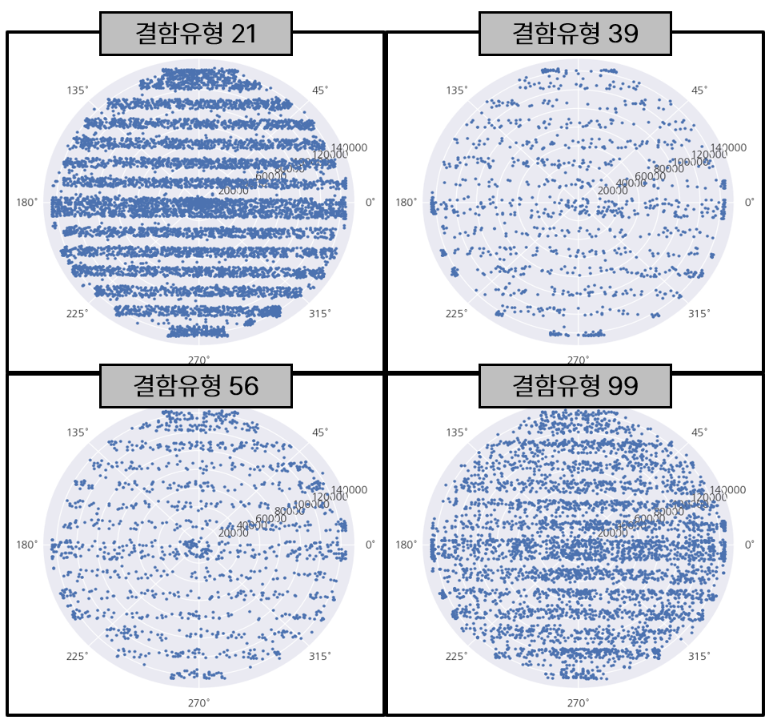
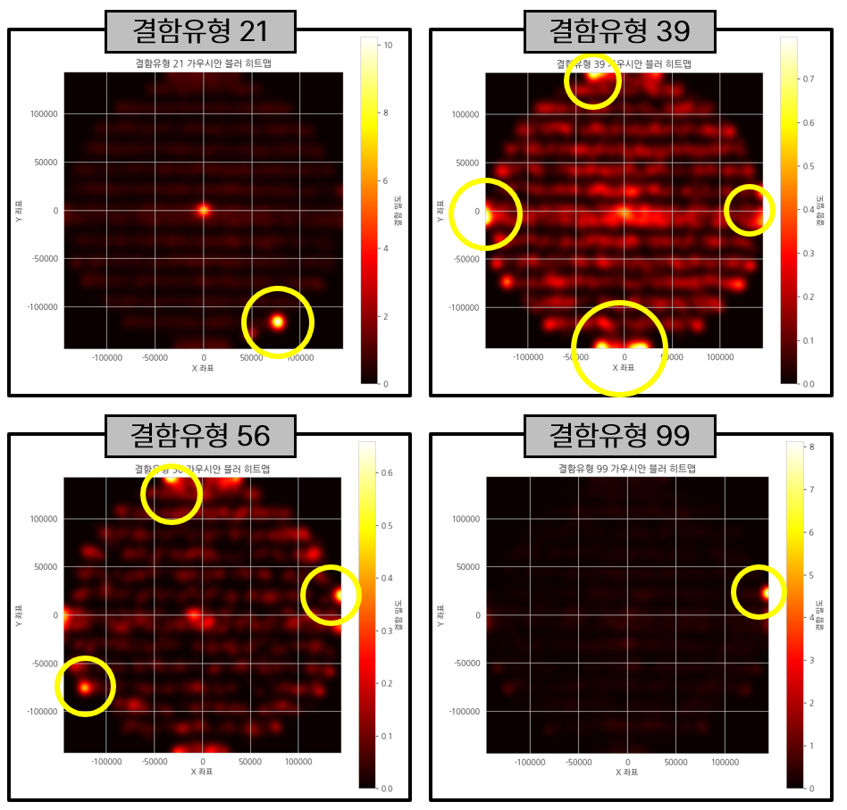

# Project 01. 웨이퍼 결함의 공간 패턴 분석

[전체 포트폴리오](../README.md)

63,909건의 웨이퍼 결함 데이터를 좌표·밀도·반경 구간으로 분석해 결함 유형별 반복 위치와 공정 차이를 확인했습니다.

| 분석 데이터 | 주요 변수 | 비교 공정 | 핵심 관찰 |
|---|---|---|---|
| 63,909건 | 25개 | PC · RMG · CBCMP | Edge 영역의 반복적인 고밀도 지점 |

## 문제와 접근

표 형태의 집계만으로는 결함이 어느 위치에 집중되는지, 공정별 패턴이 어떻게 다른지 파악하기 어려웠습니다.

1. 결함 유형·크기·광학 특성과 공정별 분포를 EDA로 확인했습니다.
2. 중심거리와 방향각도를 활용한 극좌표 시각화로 위치를 비교했습니다.
3. 가우시안 블러 히트맵으로 결함 밀집 구간을 확인했습니다.
4. Center / Mid / Edge 반경 구간별 비율을 비교해 공간적 가설을 검토했습니다.

## 시각화

## 결과와 해석

- 결함 유형 **21·39·56·99**에서 가장자리 영역의 반복적인 고밀도 지점을 관찰했습니다.
- 결함 유형과 공정에 따라 공간 패턴이 달라지는 것을 확인했습니다.
- Edge 영역의 공정 산포와 관련 조건을 후속 점검 대상으로 제안했습니다.

좌표 패턴은 원인을 확정하는 근거로는 부족합니다. 설비·재료·공정 변수와 결합한 분석 및 정량적 검증이 필요합니다.

## 본인 기여

좌표·결함 유형 EDA, 극좌표/히트맵 시각화, 결과 해석을 수행했습니다.

## 기술

Python · Pandas · NumPy · Matplotlib · Seaborn · SciPy

## 분석 자료

- [분석 보고서](%EB%B6%88%EB%9F%89%EC%9D%80_%EC%9A%B0%EC%97%B0%EC%9D%B4_%EC%95%84%EB%8B%88%EB%8B%A4_%EB%8D%B0%EC%9D%B4%ED%84%B0_%EC%8B%9C%EA%B0%81%ED%99%94%EB%A1%9C_%EC%B0%BE%EB%8A%94_%EC%88%A8%EC%9D%80_%EC%9D%B4%EC%83%81%ED%83%90%EC%A7%80.pdf)
- [전체 분석 노트북](%EC%86%8C%EC%8A%A4%EC%BD%94%EB%93%9C%28%EB%B6%88%EB%9F%89%EC%9D%80_%EC%9A%B0%EC%97%B0%EC%9D%B4_%EC%95%84%EB%8B%88%EB%8B%A4_%EB%8D%B0%EC%9D%B4%ED%84%B0_%EC%8B%9C%EA%B0%81%ED%99%94%EB%A1%9C_%EC%B0%BE%EB%8A%94_%EC%88%A8%EC%9D%80_%EC%9D%B4%EC%83%81%ED%83%90%EC%A7%80%29.ipynb)
