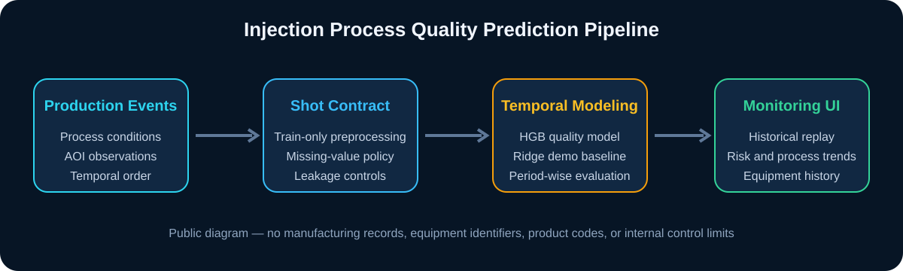
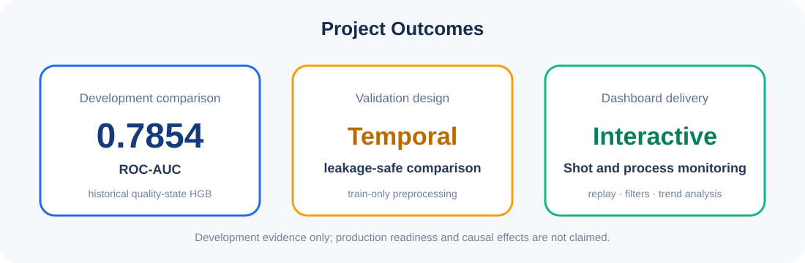

<h2># Project 04 — 사출 공정 품질 예측 및 모니터링 대시보드</h2>

> **Injection Process Quality Prediction & Monitoring Dashboard**

---

### Background

사출 공정에서는 동일한 공정 조건에서도 제품 품질이 달라질 수 있으며, 품질 결과는 사후 AOI 검사에서 확인된다.
본 프로젝트는 생산·공정 이력을 활용해 품질 위험을 사전에 예측하고, 현장 사용자가 Shot 흐름과 공정 상태를 함께 확인할 수 있는 모니터링 대시보드를 구현하는 것을 목표로 한다.

> 보안 및 기밀 유지 정책에 따라 원본 제조 데이터, 내부 공정 규격, 모델 파일 및 실행 코드는 공개하지 않는다. 이 페이지에는 비식별화된 방법론과 요약 결과만 제공한다.

  

---

### Summary

- **(1) Problem Definition**
  - 제품 단위 AOI 결과와 공정 이력을 연결해 품질 위험을 예측
  - 실제 생산 순서를 보존한 시간 기반 검증으로 데이터 누수 방지
  - 분석 결과를 현장 의사결정에 활용할 수 있도록 Streamlit 대시보드로 구현

- **(2) Data & Preprocessing**
  - 분석 단위를 생산 이벤트와 공정 이력을 결합한 Shot 수준으로 정의
  - Train 구간에서만 결측 대체값과 전처리 파라미터를 산출
  - 시간 순서를 보존한 개발/검증 분할과 미래 정보 차단
  - 보안상 실제 행 수, 설비명, 품번, 시간, 사내 규격은 비공개

- **(3) Modeling**
  - 공정조건 기반 선형 기준모델과 과거 품질상태 기반 트리 모델을 비교
  - 시간 기반 검증에서 기간별 성능과 calibration 변화를 함께 점검
  - 과거 품질상태를 반영한 Histogram Gradient Boosting 모델이 개발 비교에서 **ROC-AUC 0.7854**를 기록
  - 고정 Ridge 공정모델은 별도의 운영 시연 기준선으로 사용하여 분석 모델과 대시보드 시연 모델의 역할을 구분

- **(4) Dashboard**
  - Shot 단위 historical replay와 Play/Pause/Reset 제어
  - 필터 조건에 따른 실시간 KPI, 예측 불량 확률 추이, 공정조건 누적 추이
  - 4단계 상태 구분: Normal / Warning / Watch / Critical
  - Shot 선택 시 9개 공식 공정조건과 선형 점수 기여 방향 확인
  - 설비별 비교 및 기간·설비별 공정 이력 분석
  - UCL/LCL 기반 공정조건 상태 표시와 현장 점검 가이드 제공

- **(5) Validation & Leakage Control**
  - 전처리·특징 생성·모델 적합을 시간 순서에 맞게 분리
  - 검증 기간의 AOI 결과와 실제 FAI를 예측 입력으로 사용하지 않음
  - 동일 타임스탬프 Shot을 원자적으로 공개하여 부분 노출 방지
  - 개발 중 확인한 Holdout은 독립적인 최종 검증이 아닌 historical replay로 명시

  

- **(6) Key Findings**
  - 공정조건만으로는 기간 변화에 대한 안정적 추가 신호가 제한적이었음
  - 과거 품질상태를 반영한 모델에서 더 높은 분류력이 확인됨
  - 단일 성능 수치보다 시간 구간별 안정성, calibration, 누수 통제가 중요함
  - 대시보드는 모델 점수를 원인으로 단정하지 않고 점검 우선순위와 공정 상태를 함께 제시하도록 설계

- **(7) Retrospective**
  - AOI 선별 모집단이므로 예측값을 전체 생산 불량률로 해석할 수 없음
  - 설비와 품번의 구조적 연관으로 개별 효과의 인과적 분리가 제한됨
  - 운영 전에는 신규 기간 데이터로 독립 검증하고 AOI 결과 확정 시점을 명확히 해야 함
  - 실제 배포 환경에서는 데이터 접근통제, 모델 모니터링, 재학습 승인 절차가 추가로 필요함

---

### Stack

`Python` · `Pandas` · `NumPy` · `Scikit-learn` · `Histogram Gradient Boosting` · `Ridge` · `Streamlit` · `Plotly` · `Pytest`

---

### Public Scope

| 공개 항목 | 제공 여부 |
|---|---:|
| 문제 정의·분석 방법론 | 공개 |
| 비식별 성능 요약 | 공개 |
| 대시보드 기능 및 구조 | 공개 |
| 원본 제조 데이터 | 비공개 |
| 설비·품번·생산시각 식별정보 | 비공개 |
| 내부 공정 규격 및 관리한계 | 비공개 |
| 모델 파일 및 운영 코드 | 비공개 |

---

### Role

데이터 구조 및 품질 타깃 검토, 시간 기반 검증 설계, 모델 비교, 누수 감사, Streamlit 대시보드 설계·구현·테스트를 수행했다.
