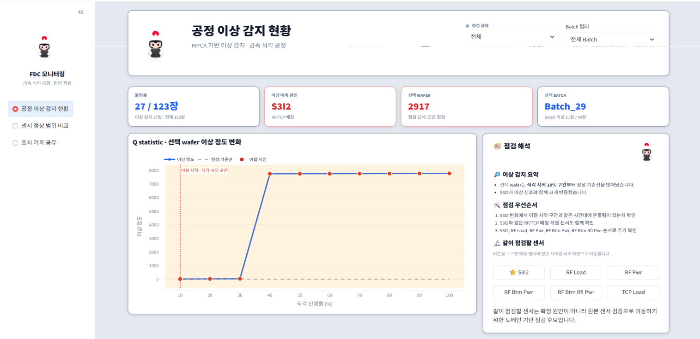

# 박준영 | Data Analytics Portfolio

## 공정 데이터를 의사결정으로 연결하다

반도체·제조 데이터를 분석해 결함의 공간 패턴을 찾고, 품질 위험과 공정 이상을 예측했습니다.
분석 결과를 센서 점검 우선순위와 Streamlit 대시보드로 전달하는 과정을 네 프로젝트에 담았습니다.

**관심 분야** Data Analyst · QA/QC · Manufacturing Analytics  
[GitHub](https://github.com/Ttoad2ng) · [Email](mailto:diaheejung@naver.com) · [FDC 대시보드](https://fdc-monitoring-dashboard-pprv4chs5yrhooo2dpm3oy.streamlit.app/)

## 프로젝트 한눈에 보기

| 프로젝트 | 해결한 문제와 접근 | 주요 결과 |
|---|---|---|
| [01. 웨이퍼 결함 시각화](01_wafer_defect_detection/) | 좌표·밀도·반경 구간으로 결함 유형과 공정 차이 분석 | 63,909건·25개 변수, Edge 영역 반복 패턴 관찰 |
| [02. 패키징 불량 예측](02_semiconductor_packaging_BOL/) | 통계 검정으로 후보 변수를 좁히고 분류 모델 비교 | LightGBM Test ROC-AUC **0.962**, F1 **0.832** |
| [03. 금속 식각 FDC](03_metal_etch_FDC_dashboard/) | 배치 drift를 반영한 MPCA와 센서 기여도 분석 | Recall **100%**, F1 **93%**, 배치별 FAR 약 **3%** |
| [04. 사출 품질 예측](04_injection_process_quality_prediction/) | 과거 품질이력 기반 분류와 Shot 단위 기준선 검증 | HGB Test ROC-AUC **0.7854**, Ridge pooled MAE **0.4137** |

> 성능은 포트폴리오에 기록된 프로젝트별 평가 결과입니다. 데이터·분석 단위·평가 조건이 다르므로 프로젝트 간 직접 비교 지표가 아닙니다.

## 01. 웨이퍼 결함의 공간 패턴

극좌표 시각화와 가우시안 블러 히트맵, 반경 구간 비율로 결함 위치를 비교했습니다.
유형 21·39·56·99에서 Edge 영역의 반복적인 고밀도 지점을 관찰하고 가장자리 공정 조건을 후속 점검 대상으로 제안했습니다.

**기여** 좌표·결함 유형 EDA, 극좌표/히트맵 시각화, 결과 해석  
**기술** Python · Pandas · NumPy · Matplotlib · Seaborn · SciPy

[분석 내용과 노트북 보기](01_wafer_defect_detection/)

## 02. 패키징 공정 불량 예측

16,998개 샘플과 5단계·40개 센서 변수를 분석했습니다.
분포 검정, 카이제곱 검정, 구간별 불량률 차이로 14개 후보 변수를 선별하고 LightGBM·XGBoost·Random Forest를 비교했습니다.
LightGBM은 임계값 0.5에서 Recall 0.847, Precision 0.817을 기록했습니다.

**기여** 센서 EDA, 통계 검정, 모델링 실험·성능 비교, 결과 해석  
**기술** Python · SciPy · Scikit-learn · LightGBM · XGBoost · SHAP

[모델 성능과 센서 점검 우선순위 보기](02_semiconductor_packaging_BOL/)

## 03. 배치 drift를 반영한 금속 식각 FDC

EV·OES·RFM 센서 데이터를 통합하고 정상 패턴 기반 MPCA를 적용했습니다.
배치별 관리한계로 정상 분포 차이를 반영하고, 잔차 기여도를 통해 이상 신호에 기여한 센서 후보를 도출했습니다.
대시보드에서 이상 감지 현황, 센서 점검, 조치 기록을 연결했습니다.

**기여** 데이터 통합·EDA, MPCA 모델링·해석 참여, Streamlit 대시보드 구현  
**기술** Python · PCA/MPCA · Scikit-learn · Streamlit · Plotly

[프로젝트 상세](03_metal_etch_FDC_dashboard/) · [대시보드 열기](https://fdc-monitoring-dashboard-pprv4chs5yrhooo2dpm3oy.streamlit.app/)

## 04. 사출 품질 예측과 모니터링

공정조건만 사용한 모델의 한계를 확인한 뒤, 예측시점 이전 품질이력을 반영하도록 문제를 재정의했습니다.
제품 행 단위 HGB 분류와 Shot 단위 Ridge 기준선을 별도 트랙으로 검증했습니다.

| 트랙 | 결과 |
|---|---|
| 품질이력 HGB 분류 | Test ROC-AUC 0.7854 · Recall 71.78% · Precision 86.70% |
| Shot 단위 Ridge 기준선 | Pooled MAE 0.4137 · 2월 MAE 약 0.468 |
| 대시보드 시연 | 22,407 Shot historical replay · 4단계 경보·공정 이력 화면 |

**기여** 데이터 구조·품질 EDA/전처리 검토, 모델링 실험·비교, 한계 해석, Streamlit 구현  
**기술** Python · Scikit-learn · Histogram Gradient Boosting · Ridge · Streamlit · Plotly · Pytest

[검증 설계와 공개 범위 보기](04_injection_process_quality_prediction/)

## 분석 역량

| 영역 | 적용 경험 |
|---|---|
| 문제 정의·EDA | 공간 패턴 분석, 센서 분포 비교, 동일 Shot 품질 혼재 확인 |
| 통계 분석 | 정규성 검정, Welch t-test, Mann–Whitney U-test, 카이제곱 검정 |
| 모델링·검증 | 분류 모델 비교, 시간 순서 분할, 학습 구간 전처리, 임계값 평가 |
| 이상 탐지 | PCA/MPCA, T²·Q 통계량, 배치 drift, 센서 기여도 해석 |
| 결과 전달 | KPI, 점검 우선순위, Streamlit 대시보드, historical replay |

반도체 공정·소자 학습, MOSFET 제작·측정, OES 플라즈마 진단 경험을 제조 데이터 분석에 연결했습니다.

## 공개 범위와 연락처

프로젝트별로 분석 코드·보고서·시각화를 제공합니다.
사출 프로젝트는 비식별 방법론과 요약 결과를 공개하며, 원본 제조 데이터·내부 규격·모델 파일·운영 코드는 비공개입니다.

**박준영** · [diaheejung@naver.com](mailto:diaheejung@naver.com) · [github.com/Ttoad2ng](https://github.com/Ttoad2ng)
